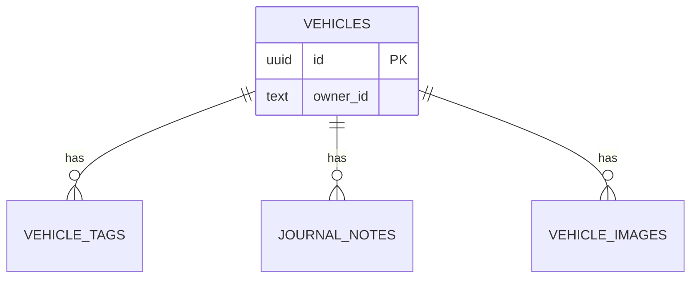

# Data Model: Vehicle Tracking

Persistence is split: structured data lives in `MyGarage.Database` (PostgreSQL, plain SQL migrations) and image files live in Azure Blob Storage (a private container, accessed only by the API through the image repository). Data records are internal to Database and the Api mapping layer; only the DTOs in `MyGarage.Shared` cross the API boundary.

## Entity relationship

Owner is the authenticated user's id (`oid`, fallback `sub`); there is no users table in this feature. All child rows cascade-delete with their vehicle; the matching blobs are deleted right after the vehicle's transaction commits.

## Tables

### vehicles (`0001_create_vehicles.sql`)

| Column | Type | Null | Notes |
|---|---|---|---|
| `id` | uuid | no | PK; UUID v7 generated by the Api. |
| `owner_id` | text | no | From validated claims only. |
| `nickname` | varchar(100) | no | |
| `make` | varchar(50) | no | |
| `model` | varchar(50) | no | |
| `trim` | varchar(50) | yes | |
| `color` | varchar(30) | yes | |
| `mileage` | integer | yes | `CHECK (mileage BETWEEN 0 AND 9999999)`. |
| `doors` | smallint | yes | `CHECK (doors BETWEEN 1 AND 6)`. |
| `created_at` / `updated_at` | timestamptz | no | UTC. |
| `created_by` / `updated_by` | text | no | Owner id of the acting user. |

Indexes: `ix_vehicles_owner_nickname (owner_id, lower(nickname), id)` (garage list and search/filter are always owner-scoped; at tens of rows per owner no further search index is needed).

### vehicle_tags (`0002_create_vehicle_tags.sql`)

| Column | Type | Null | Notes |
|---|---|---|---|
| `id` | uuid | no | PK. |
| `vehicle_id` | uuid | no | FK -> `vehicles(id)` ON DELETE CASCADE. |
| `name` | varchar(30) | no | Trimmed display text. |
| `name_key` | text | no | Generated: `lower(name)`. |
| `created_at` | timestamptz | no | |

Constraints: `UNIQUE (vehicle_id, name_key)`. Limit of 20 per vehicle is enforced transactionally in the add statement (research R7).

### journal_notes (`0003_create_journal_notes.sql`)

| Column | Type | Null | Notes |
|---|---|---|---|
| `id` | uuid | no | PK. |
| `vehicle_id` | uuid | no | FK -> `vehicles(id)` ON DELETE CASCADE. |
| `category` | varchar(40) | yes | Free text chosen by the user, trimmed; blank is stored as NULL (uncategorized). No predefined list or check constraint. |
| `body` | varchar(4000) | no | Plain text. |
| `created_at` / `updated_at` | timestamptz | no | UTC; `created_at` is the date shown to the user. |
| `created_by` / `updated_by` | text | no | |

Indexes: `ix_journal_notes_vehicle_created (vehicle_id, created_at DESC, id DESC)`.

### vehicle_images (`0004_create_vehicle_images.sql`)

Metadata only; the file itself is a blob named `{vehicle_id}/{id}` in container `vehicle-images`.

| Column | Type | Null | Notes |
|---|---|---|---|
| `id` | uuid | no | PK. |
| `vehicle_id` | uuid | no | FK -> `vehicles(id)` ON DELETE CASCADE. |
| `content_type` | text | no | `image/jpeg`, `image/png`, or `image/webp` (detected by signature). |
| `size_bytes` | integer | no | `CHECK (size_bytes BETWEEN 1 AND 5242880)`. |
| `caption` | varchar(200) | yes | |
| `is_main` | boolean | no | Default false. |
| `created_at` | timestamptz | no | |
| `created_by` | text | no | |

Indexes: `ix_vehicle_images_vehicle (vehicle_id, created_at, id)`; partial unique `ux_vehicle_images_main (vehicle_id) WHERE is_main`. Limit of 10 per vehicle is enforced transactionally in the add statement.

### Blob container `vehicle-images`

Private (no anonymous access). Blob name `{vehicleId}/{imageId}`; blob content type equals the detected `content_type`. No metadata about the user or original file name is stored on the blob. Written, read, and deleted only after the owner-scoped SQL check succeeds (research R9).

### schema_migrations (created by the migration runner)

| Column | Type | Notes |
|---|---|---|
| `script_id` | text PK | For example `0001_create_vehicles`. |
| `checksum` | text | SHA-256 of the script text. |
| `applied_at` | timestamptz | |

## Data records (`MyGarage.Database`, internal to the data/mapping layers)

`VehicleRecord` (all vehicle columns), `VehicleSummaryRecord` (id, nickname, make, model, mileage, `MainImageId`), `VehicleFilterOptionsRecord` (distinct makes, colors, tag names), `VehicleSearchCriteria` (q, make, color, doors, tag, min/max mileage, page, page size), `VehicleTagRecord`, `JournalNoteRecord` (category as `string?`), `VehicleImageRecord` (metadata only), `VehicleImageContent` (content type + readable stream), generic `PagedResult<T>`.

## DTOs (`MyGarage.Shared/Vehicles`)

| DTO | Fields |
|---|---|
| `VehicleSummaryDto` | `Id`, `Nickname`, `Make`, `Model`, `Mileage?`, `MainImageId?` (card). |
| `VehicleDetailDto` | `Id`, `Nickname`, `Make`, `Model`, `Trim?`, `Color?`, `Mileage?`, `Doors?`, `Tags: VehicleTagDto[]`, `Images: VehicleImageDto[]`, `CreatedAt`, `UpdatedAt`. |
| `CreateVehicleRequest` / `UpdateVehicleRequest` | `Nickname`, `Make`, `Model`, `Trim?`, `Color?`, `Mileage?`, `Doors?` (update replaces all editable fields). |
| `VehicleTagDto` | `Id`, `Name`. |
| `AddVehicleTagRequest` | `Name`. |
| `JournalNoteDto` | `Id`, `Category?` (string), `Body`, `CreatedAt`, `UpdatedAt`. |
| `JournalNoteRequest` (create and update) | `Body`, `Category?` (string, free text, blank = none). |
| `VehicleImageDto` | `Id`, `Caption?`, `IsMain`, `ContentType`, `SizeBytes`, `CreatedAt`. |
| `VehicleFilterOptionsDto` | `Makes: string[]`, `Colors: string[]`, `Tags: string[]` (distinct values in the caller's garage). |
| `PagedResultDto<T>` | `Items`, `Page`, `PageSize`, `TotalCount`, `TotalPages`. |

List query parameters for `GET /api/vehicles` (not a DTO body): `q`, `make`, `color`, `doors`, `tag`, `minMileage`, `maxMileage`, `page`, `pageSize` (see [contracts/api.openapi.yaml](contracts/api.openapi.yaml)).

No DTO has an owner or user id field. Upload is `multipart/form-data` (`file`, `caption?`) and has no DTO body.

## Validation rules

See research R13 for the consolidated limits. Rules are implemented as FluentValidation validators in `MyGarage.Api/Vehicles` (one per request type, plus paging query and upload validators); database constraints repeat the hard limits as a safety net.

## State transitions

- **Vehicle**: created -> edited (any number of times) -> deleted (cascade removes tags, notes, images). No soft delete.
- **Image main flag**: first image becomes main -> user can set another as main (old cleared in the same transaction) -> deleting the main promotes the oldest remaining image; deleting the last image leaves the vehicle with no main image (placeholder shown).
- **Image row and blob**: row inserted and blob uploaded inside one database transaction, commit last; on delete the row is removed and committed first, then the blob (an orphan blob is possible only if that final delete fails, and is private and logged).
- **Note**: created -> edited (updates `updated_at`/`updated_by`) -> deleted.
