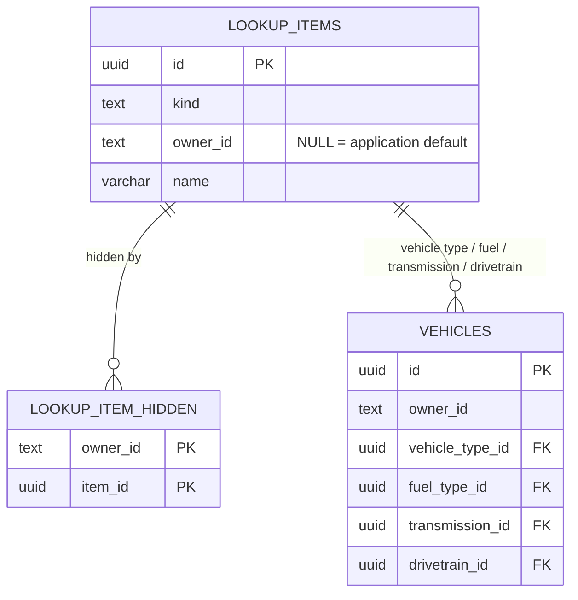

# Data Model: Expanded Vehicle Details and Lookup Preferences

Structured data lives in `MyGarage.Database` (PostgreSQL, plain SQL migrations). Data records are internal to Database and the Api mapping layer; only DTOs in `MyGarage.Shared` cross the API boundary. This feature adds two tables and extends `vehicles`; image blobs are unaffected.

## Entity relationship

Owner is the authenticated user's id (`oid`, fallback `sub`); there is no users table. Default items have no owner and are never modified by users.

## Tables

### lookup_items (`0005_create_lookup_items.sql`)

| Column | Type | Null | Notes |
|---|---|---|---|
| `id` | uuid | no | PK. Defaults use fixed ids declared in the migration; custom items use UUID v7 generated by the Api. |
| `kind` | text | no | `CHECK (kind IN ('vehicle_type', 'fuel_type', 'transmission', 'drivetrain'))`. |
| `owner_id` | text | yes | NULL = application default (visible to all, read-only); otherwise the user who added the item (visible only to them). |
| `name` | varchar(30) | no | Trimmed display text. |
| `name_key` | text | no | Generated: `lower(name)`. |
| `sort_order` | integer | no | Display order for defaults (1..n per kind); 0 for custom items, which are listed after the defaults by `name_key`. |
| `created_at` | timestamptz | no | UTC. |
| `created_by` | text | yes | NULL for defaults. |

Constraints and indexes:

- `ux_lookup_items_default (kind, name_key) WHERE owner_id IS NULL`
- `ux_lookup_items_custom (owner_id, kind, name_key) WHERE owner_id IS NOT NULL`
- `CHECK ((owner_id IS NULL) = (created_by IS NULL))`
- The limit of 50 custom items per owner and kind and the cross-check against default names are enforced transactionally in the insert (research R4).

Seeded defaults (display order):

| Kind | Items |
|---|---|
| `vehicle_type` | Sedan, SUV, Coupe, Hatchback, Convertible, Truck, Van, Wagon, Minivan, Crossover, Motorcycle |
| `fuel_type` | Gasoline, Diesel, Electric, Hybrid |
| `transmission` | Automatic, Manual |
| `drivetrain` | FWD, RWD, AWD, 4WD |

### lookup_item_hidden (`0005_create_lookup_items.sql`)

| Column | Type | Null | Notes |
|---|---|---|---|
| `owner_id` | text | no | The user who hid the item. |
| `item_id` | uuid | no | FK -> `lookup_items(id)` ON DELETE CASCADE. |
| `hidden_at` | timestamptz | no | UTC. |

PK `(owner_id, item_id)`. A row means "hidden for this user"; deleting the row shows the item again. Statements verify the item is a default or owned by the same owner before inserting.

### vehicles (`0006_add_vehicle_details.sql`) - new columns

Existing columns are unchanged (`id`, `owner_id`, `nickname`, `make`, `model`, `trim`, `color`, `mileage`, `doors`, audit columns). All new columns are nullable so existing rows stay valid; the Api requires `year` on every create and update.

| Column | Type | Notes |
|---|---|---|
| `vin` | varchar(17) | Upper case; `CHECK (vin ~ '^[A-HJ-NPR-Z0-9]{17}$')`. |
| `year` | smallint | `CHECK (year BETWEEN 1900 AND 2200)`; the "next calendar year" ceiling is applied by the validator. |
| `vehicle_type_id` | uuid | FK -> `lookup_items(id)` ON DELETE RESTRICT. |
| `ownership` | text | `CHECK (ownership IN ('purchased', 'leased'))`. |
| `purchased_on` | date | |
| `lease_ends_on` | date | `CHECK (lease_ends_on IS NULL OR COALESCE(ownership = 'leased', false))`; `CHECK (lease_ends_on IS NULL OR purchased_on IS NULL OR lease_ends_on >= purchased_on)`. |
| `engine` | varchar(100) | Free text. |
| `horsepower` | integer | `CHECK (horsepower BETWEEN 1 AND 3000)`. |
| `fuel_type_id` | uuid | FK -> `lookup_items(id)` ON DELETE RESTRICT. |
| `transmission_id` | uuid | FK -> `lookup_items(id)` ON DELETE RESTRICT. |
| `seats` | smallint | `CHECK (seats BETWEEN 1 AND 20)`. |
| `drivetrain_id` | uuid | FK -> `lookup_items(id)` ON DELETE RESTRICT. |
| `wheel_size` | numeric(3,1) | Inches; `CHECK (wheel_size BETWEEN 10 AND 30)`. |
| `tire_size` | varchar(20) | Free text. |

Migration `0007` later replaces `ix_vehicles_owner_nickname` with `ix_vehicles_owner_name` (see Amendment 1 below); at tens of rows per owner no further indexes are needed (foreign key columns are not indexed because deleting lookup items never happens in v1).

### schema_migrations

Unchanged; records `0005_create_lookup_items`, `0006_add_vehicle_details`, `0007_drop_vehicle_nickname`, and `0008_create_features` with checksums.

## Data records (`MyGarage.Database`)

- `LookupItemRecord` (id, kind, name, isDefault, isHidden, sortOrder). `LookupKind` maps slugs to stored kind values.
- `VehicleRecord`: all vehicle columns including the new ones and the four lookup item ids; the read model adds the four item names (via `LEFT JOIN lookup_items`).
- `VehicleSummaryRecord`: id, year, make, model, mileage, `MainImageId` (no nickname after Amendment 1).
- `VehicleFilterOptionsRecord`: makes, colors, tag names, plus used vehicle types, fuel types, transmissions, drivetrains as `(id, name)` pairs.
- `VehicleSearchCriteria`: gains `MinYear`, `MaxYear`, `VehicleTypeId`, `FuelTypeId`, `TransmissionId`, `DrivetrainId`.

## DTOs (`MyGarage.Shared`)

### Lookups (`Lookups/`)

| DTO | Fields |
|---|---|
| `LookupKinds` (constants) | `vehicle-types`, `fuel-types`, `transmissions`, `drivetrains`. |
| `LookupItemDto` | `Id`, `Name`, `IsDefault`, `IsHidden`. |
| `LookupsDto` | `VehicleTypes`, `FuelTypes`, `Transmissions`, `Drivetrains` (each `LookupItemDto[]`). |
| `LookupValueDto` | `Id`, `Name` (a vehicle's chosen item or a filter choice). |
| `AddLookupItemRequest` | `Name`. |
| `SetLookupVisibilityRequest` | `IsHidden`. |

### Vehicles (`Vehicles/`) - changes

| DTO | Change |
|---|---|
| `OwnershipType` (new enum) | `Purchased`, `Leased`; serialized as strings. |
| `VehicleRequest` | Adds `Vin?`, `Year?` (validated as required), `VehicleTypeId?`, `Ownership?`, `PurchasedOn?` (`DateOnly`), `LeaseEndsOn?` (`DateOnly`), `Engine?`, `Horsepower?`, `FuelTypeId?`, `TransmissionId?`, `Seats?`, `DrivetrainId?`, `WheelSize?` (`decimal`), `TireSize?`. Existing fields unchanged. |
| `VehicleDetailDto` | Adds the same fields, with `VehicleType?`, `FuelType?`, `Transmission?`, `Drivetrain?` as `LookupValueDto` (id and name). |
| `VehicleSummaryDto` | Adds `Year?`. |
| `VehicleFilterOptionsDto` | Adds `VehicleTypes`, `FuelTypes`, `Transmissions`, `Drivetrains` as `LookupValueDto[]`. |

List query parameters for `GET /api/vehicles` gain `minYear`, `maxYear`, `vehicleTypeId`, `fuelTypeId`, `transmissionId`, `drivetrainId` (see [contracts/api.openapi.yaml](contracts/api.openapi.yaml)). No DTO carries an owner or user id.

## Validation rules

See research R6 for the consolidated limits. Implemented as FluentValidation validators in `MyGarage.Api` (`VehicleRequestValidator` extended; `AddLookupItemRequestValidator`, `SetLookupVisibilityRequestValidator`, and a `LookupKind` route check new); database `CHECK` constraints repeat the hard limits. Kind and availability of referenced lookup items are verified by `VehicleService` (research R3).

## State transitions

- **Default lookup item**: exists from its migration onward; never changed or deleted by users. Per user it is shown (no hidden row) or hidden (hidden row); toggling is idempotent.
- **Custom lookup item**: created (owner-scoped, limits and uniqueness enforced) -> hidden/shown any number of times. Not renamed or deleted in v1, so no vehicle can reference a missing item.
- **Vehicle**: created with a year -> edited any number of times (year stays required; a pre-existing vehicle with no year acquires one on its next successful edit) -> deleted (existing cascade removes tags, notes, images). A vehicle's lookup references survive their items being hidden.
- **Ownership fields**: `leased` allows a lease end date; changing a vehicle to `purchased` (or clearing ownership) requires clearing the lease end date in the same save.

## Amendment 1 (2026-11-02): vehicle name and shared features

### vehicles (`0007_drop_vehicle_nickname.sql`)

Drops `vehicles.nickname` and `ix_vehicles_owner_nickname`; adds `ix_vehicles_owner_name` on `(owner_id, lower(make), lower(model), year, id)`, the access path for the owner-scoped list (ordered by make, model, year, id). `VehicleRecord` and `VehicleSummaryRecord` lose `Nickname`. The DTOs (`VehicleDetailDto`, `VehicleSummaryDto`) gain a computed, non-serialized `Name` from `VehicleName.Compose(year, make, model)`; `VehicleRequest` loses `Nickname`.

### features (`0008_create_features.sql`)

| Column | Type | Null | Notes |
|---|---|---|---|
| `id` | uuid | no | PK. |
| `name` | varchar(30) | no | Canonical casing of the first creator. |
| `name_key` | text | no | `GENERATED ALWAYS AS (lower(name)) STORED`; unique index `ux_features_name`. |
| `created_at` | timestamptz | no | UTC. |
| `created_by` | text | no | Owner who first created it; never returned by any endpoint. |

`vehicle_tags` becomes the vehicle-to-feature link: `(id, vehicle_id, feature_id NOT NULL FK -> features ON DELETE RESTRICT, created_at)` with `UNIQUE (vehicle_id, feature_id)` and `ix_vehicle_tags_feature`; its `name` and `name_key` columns are dropped (`name_key` first, because it is generated from `name`). The migration backfills one feature per `lower(name)` from the existing tags (earliest casing and creator) and links every existing tag. Suggestions (`SuggestFeatures.sql`) return only features with at least one link, most used first.
