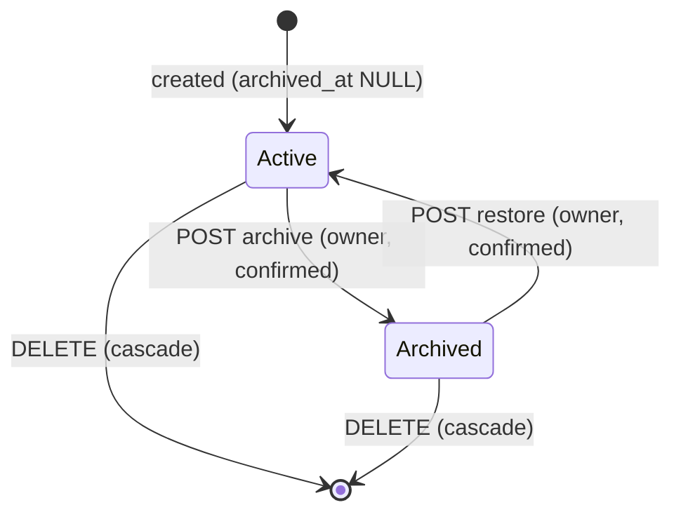

# Data Model: Archive Vehicle

Design for [plan.md](plan.md). Decisions and alternatives are in [research.md](research.md). Persistence types stay internal to `MyGarage.Database` and the Api mapper; the DTOs live in `MyGarage.Shared`.

## Schema change (migration `0018_add_vehicle_archive.sql`)

```text
vehicles
  + archived_at   timestamptz  NULL          -- NULL = active; a value = the instant the owner archived it
  + INDEX ix_vehicles_owner_active ON vehicles (owner_id) WHERE archived_at IS NULL
```

- Forward-only; no data is rewritten. Every existing vehicle has `archived_at = NULL`, so it is active (FR-014).
- No new table. Reminders, notifications, drafts, and every child table are unchanged.
- Archiving also sets `updated_at` and `updated_by` on the vehicle (attribution, FR-012). Restoring does the same and sets `archived_at` back to `NULL`.

## Vehicle states



| State | Readable | Writable | In the default list | In garage figures | Offered for new work |
|---|---|---|---|---|---|
| Active | yes | yes | yes | yes | yes |
| Archived | yes (all history) | no (409), except restore and delete | only with Archived or All | only fuel and charging (see below) | no |

## Derived value: reminder effective status

Nothing is stored on `reminders` for archiving. `ReminderStatus` is derived on every read:

| Vehicle | Reminder `is_paused` | Status |
|---|---|---|
| Archived | any | **Archived** (new): disabled, no urgency, no next-due warning |
| Active | true | Paused |
| Active | false | Upcoming, Due soon, Overdue, or Mileage needed, as in feature 013 |

Restore therefore returns each reminder to exactly the status it had, and a user-paused reminder stays Paused. Archived reminders sort after Paused.

## Where archived vehicles are included or excluded

| Surface | Script (changed) | Archived vehicles |
|---|---|---|
| Vehicle list, count, search | `Vehicles/ListPage.sql`, `Count.sql` | By `@Status`: `active` (default) excludes, `archived` only, `all` includes |
| Filter choices (make, color, tags, lookups) | `Vehicles/FilterOptions.sql` | Follow `@Status` |
| Vehicle detail | `Vehicles/GetById.sql` | Returned, with `archived_at` |
| Vehicle count on dashboard | `Dashboard/Counts.sql` | Excluded |
| Service record count on dashboard | `Dashboard/Counts.sql` | Excluded |
| Fuel and charging entry count | `Dashboard/Counts.sql` | **Included** |
| Fuel and charging spend chart | `Dashboard/FuelEnergySpend.sql` | **Included**, with `vehicle_archived` for the legend |
| Recent activity | `Dashboard/RecentActivity.sql` | Excluded |
| Drafts awaiting review | `Dashboard/Counts.sql` | Unchanged (a draft belongs to the user) |
| Garage-wide reminders, overdue and due-soon counts, Needs attention | `Reminders/ListForOwner.sql` | Excluded |
| Reminder notifier | `Reminders/ListForEvaluation.sql` | Excluded |
| Vehicle's own Reminders tab, reminder detail | `Reminders/ListForVehicle.sql`, `GetById.sql` | Shown, status Archived |
| Draft vehicle picker and intake matching | `Drafts/ListOwnerVehicles.sql` | Excluded |
| A draft's proposed vehicle | `Drafts/ListOpenPage.sql`, `GetById.sql` | Reported as no vehicle |

## New and changed SQL scripts

| Script | Purpose |
|---|---|
| `Vehicles/Archive.sql` (new) | `UPDATE vehicles SET archived_at = @Now, updated_at = @Now, updated_by = @OwnerId WHERE id = @VehicleId AND owner_id = @OwnerId AND archived_at IS NULL RETURNING id` |
| `Vehicles/Restore.sql` (new) | The same with `archived_at = NULL` and `AND archived_at IS NOT NULL` |
| `Vehicles/GetArchivedState.sql` (new) | `SELECT archived_at IS NOT NULL FROM vehicles WHERE id = @VehicleId AND owner_id = @OwnerId`; no row means absent or not the caller's |
| `Notifications/MarkReadForVehicleReminders.sql` (new) | Sets `read_at` on the unread reminder notifications of the vehicle, scoped through `reminders` and `vehicles.owner_id`; runs in the archive transaction |
| `Vehicles/ListPage.sql`, `Count.sql`, `FilterOptions.sql` | Add the `@Status` predicate; `ListPage` also selects `v.archived_at` |
| `Vehicles/GetById.sql` | Select `v.archived_at` |
| `Reminders/ListForVehicle.sql`, `GetById.sql` | Select `v.archived_at IS NOT NULL AS vehicle_archived` |
| `Reminders/ListForOwner.sql`, `ListForEvaluation.sql` | Add `AND v.archived_at IS NULL` |
| `Dashboard/Counts.sql` | `archived_at IS NULL` on the vehicle and service record counts only |
| `Dashboard/RecentActivity.sql` | Add `AND v.archived_at IS NULL` |
| `Dashboard/FuelEnergySpend.sql` | Select `v.archived_at IS NOT NULL AS vehicle_archived` and group by it; no filter added |
| `Drafts/ListOwnerVehicles.sql` | Add `AND archived_at IS NULL` |
| `Drafts/ListOpenPage.sql`, `GetById.sql` | Join the vehicle with `AND v.archived_at IS NULL` and select the draft's vehicle id through that join so it is null when archived |

## Persistence records (Database, internal)

- `VehicleRecord`, `VehicleSummaryRecord`: `+ ArchivedAt (DateTimeOffset?)`.
- `ReminderRecord`, `ReminderForEvaluationRecord`: `+ VehicleArchived (bool)` (the evaluation script excludes archived, so the value is always false there, kept so the shared mapper compiles for both).
- `FuelEnergySpendRecord`: `+ VehicleArchived (bool)`.
- `VehicleRepository`: `+ ArchiveAsync`, `RestoreAsync` (each returns `Archived`, `NotFound`, or `AlreadyInState`), `+ GetArchivedStateAsync`, list and count take a status criterion.

## DTOs (Shared)

| DTO | Change |
|---|---|
| `VehicleSummaryDto`, `VehicleDetailDto` | `+ ArchivedAt` (`DateTimeOffset?`; null = active) |
| `ReminderStatus` | `+ Archived` (wire value `archived`) |
| `ReminderDto` | `+ VehicleArchived` (bool, so the Web can label and hide actions without reading the vehicle) |
| `FuelEnergySpendVehicleDto` | `+ VehicleArchived` (bool) |
| Vehicle list status values | `active`, `archived`, `all` as constants; `active` when absent |

No request DTO is added: archive and restore carry no body, and the status filter is a query value.

## Validation rules

- `status` (vehicle list query): one of `active`, `archived`, `all` (case-sensitive snake_case like other enums); anything else is a `400` validation problem naming the field. Absent means `active`.
- Archive: refused with `409` when already archived; restore: refused with `409` when already active; both `404` when the vehicle is absent or not the caller's.
- Writes: any non-read request to a vehicle-scoped route for an archived vehicle is refused with `409` (`urn:mygarage:problem:vehicle-archived`) before the endpoint's own validation runs.
- Draft include into an archived vehicle: refused through the existing unknown-vehicle validation path.

## Relationships and lifecycle

- A vehicle belongs to one owner; archiving does not change ownership, children, blobs, or any foreign key.
- Deleting a vehicle, archived or not, cascades exactly as today (tags, notes, images, service records, entries, documents, reminders, completions, reminder notifications).
- Reminder `notified_state` is not changed by archive or restore.
