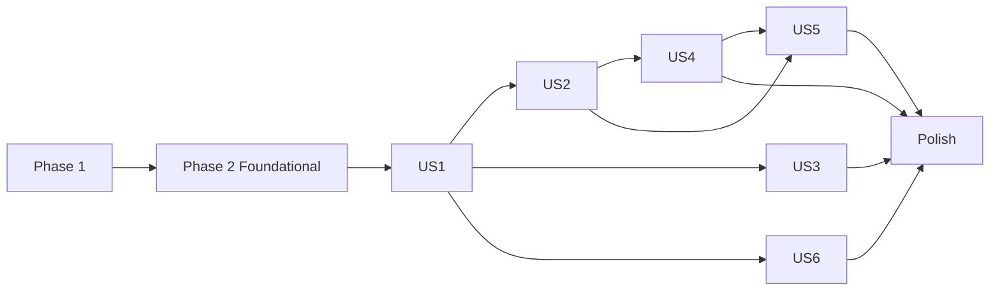

---

description: "Task list for Archive Vehicle"
---

# Tasks: Archive Vehicle

**Input**: Design documents from `/specs/014-archive-vehicle/`

**Prerequisites**: plan.md, spec.md (with the 2026-11-08 planning refinement), research.md (D1-D11), data-model.md, contracts/api.openapi.yaml, contracts/web-routes.md, quickstart.md

**Tests**: Required (constitution VIII): write the test, run it, watch it fail for the right reason, then implement. The database is never mocked (Testcontainers PostgreSQL). There is no external AI or blob dependency in this feature, so the only fakes are `TimeProvider` (the clock already used by the reminder and draft tests) and the Api behind the Web (fake `HttpMessageHandler` or the `VehicleTestContext` responders).

**Organization**: Grouped by user story. US1 archive a vehicle and take it out of the default list (P1, smallest slice); US2 garage figures and reminders (P1); US3 the Active / Archived / All filter and archived labels (P2); US4 restore (P2); US5 read-only archived vehicles and draft behavior (P3); US6 delete stays available (P3). The Foundational phase holds the migration, the shared contract fields, and the archived-state read every story uses. The list's `status` predicate lives in US1 (an archived vehicle must leave the default list), and the filter links and labels in US3.

## Format: `[ID] [P?] [Story] Description`

- **[P]**: Can run in parallel (different files, no dependency on an incomplete task)
- **[Story]**: US1-US6, only on user-story phase tasks
- Names to keep identical everywhere:
  - Database: migration `0018_add_vehicle_archive`; column `vehicles.archived_at` (`timestamptz NULL`); index `ix_vehicles_owner_active`; `VehicleStateChange` (`Changed`, `NotFound`, `AlreadyInState`); `VehicleRepository.ArchiveAsync`, `RestoreAsync`, `GetArchivedStateAsync` (returns `bool?`: null = no such vehicle for that owner, true = archived); `VehicleSearchCriteria.Status` (text, default `active`); `VehicleRecord.ArchivedAt` and `VehicleSummaryRecord.ArchivedAt` (`DateTimeOffset?`); scripts `Scripts/Vehicles/Archive.sql`, `Restore.sql`, `GetArchivedState.sql`, `Scripts/Notifications/MarkReadForVehicleReminders.sql`
  - Shared: `VehicleStatusFilter` (`Active` = `"active"`, `Archived` = `"archived"`, `All` = `"all"`, `IsValid(string?)`) in `src/MyGarage.Shared/Vehicles/`; `ArchivedAt` (`DateTimeOffset?`) on `VehicleSummaryDto` and `VehicleDetailDto`; `ReminderStatus.Archived` (JSON `archived`); `ReminderDto.VehicleArchived` (bool); `FuelEnergySpendVehicleDto.VehicleArchived` (bool)
  - Api: operations `ArchiveVehicle` (`POST /api/vehicles/{vehicleId:guid}/archive`) and `RestoreVehicle` (`POST /api/vehicles/{vehicleId:guid}/restore`), no request body, `200` with `VehicleDetailDto`; `VehicleListQuery.Status`; `RequireActiveVehicleFilter`, `RequireActiveVehicleForWrites()` and the marker `ActiveVehicleRequiredMetadata` in `src/MyGarage.Api/Common/RequireActiveVehicleFilter.cs`; `VehicleArchivedProblem` with `Type` = `urn:mygarage:problem:vehicle-archived`, status `409`; `VehicleMetrics` counters `vehicles_archived` and `vehicles_restored`
  - Web: forms `archive-vehicle` and `restore-vehicle`; query values `status` (`archived`, `all`; absent means active) and `saved` (`archived`, `restored`); `VehicleStatusLinks.razor`; `VehicleArchivedState` (cascading); `ArchivedVehicleNotice.razor`; `ApiOutcome.Archived`
- Constants: status text `active` | `archived` | `all` (case-sensitive); the problem type string above; a reminder of an archived vehicle has status `archived`, which overrides `paused`
- Rule for every garage-wide figure: fuel and charging figures keep archived vehicles; every other figure leaves them out (spec FR-004)
- Guarded surfaces (11 route groups plus the vehicle update): fuel-energy-entries, inspections, insurance, registrations, taxes, service-records, reminders, documents, images, notes, tags, and `PUT /api/vehicles/{vehicleId}`. Not guarded: archive, restore, `DELETE /api/vehicles/{vehicleId}`
- No new NuGet package; no new project; `infra/` is untouched
- Never run `dotnet test` while `aspire run` is active; Docker must be running for Database and Api tests
- Work on branch `014-archive-vehicle`; never commit to `main`; merge by pull request

## Phase 1: Setup

- [X] T001 Confirm the workspace is on branch `014-archive-vehicle` (`git branch --show-current`), then run `dotnet build MyGarage.slnx` (zero warnings) and `dotnet test tests/MyGarage.Web.Tests` to record the baseline; run `tests/MyGarage.Database.Tests` and `tests/MyGarage.Api.Tests --filter "FullyQualifiedName~Vehicles|FullyQualifiedName~Reminders|FullyQualifiedName~Dashboard|FullyQualifiedName~Drafts|FullyQualifiedName~Notifications"` once as the regression baseline for the behavior this feature touches

---

## Phase 2: Foundational (Blocking Prerequisites)

**Purpose**: The schema, the contract fields, and the archived-state read. No story compiles against the archived state until these exist.

- [X] T002 [P] Add the Shared contract fields, each with `init` accessors and a one-line comment only where the meaning is not obvious: create `src/MyGarage.Shared/Vehicles/VehicleStatusFilter.cs` (static class with `Active` = `"active"`, `Archived` = `"archived"`, `All` = `"all"` and `IsValid(string? value)` returning true for null and exactly those three, case-sensitive); add `ArchivedAt` (`DateTimeOffset?`, null for an active vehicle) to `src/MyGarage.Shared/Vehicles/VehicleSummaryDto.cs` and `VehicleDetailDto.cs`; add `Archived` after `MileageNeeded` in `src/MyGarage.Shared/Reminders/ReminderStatus.cs` (wire value `archived` through the existing `SnakeCaseEnumConverter`); add `VehicleArchived` (bool) to `src/MyGarage.Shared/Reminders/ReminderDto.cs`; add `VehicleArchived` (bool) to the file in `src/MyGarage.Shared/Dashboard/` that declares `FuelEnergySpendVehicleDto`. Keep the solution compiling (new members are optional or have defaults)
- [X] T003 [P] Write failing tests in `tests/MyGarage.Database.Tests/Vehicles/VehicleArchiveMigrationTests.cs` (real PostgreSQL, helpers as in `tests/MyGarage.Database.Tests/Reminders/ReminderMigrationTests.cs`): after migration `0018_add_vehicle_archive`, `vehicles.archived_at` exists as `timestamptz` and nullable; every vehicle that existed before the migration (insert rows with the runner stopped at `0017`, then migrate) has `archived_at` NULL; the partial index `ix_vehicles_owner_active` exists on `owner_id` with the predicate `archived_at IS NULL`; no other table changed (spot check `reminders` and `notifications` column lists); migrations `0001` to `0017` checksums are unchanged
- [X] T004 Create `src/MyGarage.Database/Scripts/Migrations/0018_add_vehicle_archive.sql` (forward-only): `ALTER TABLE vehicles ADD COLUMN archived_at timestamptz NULL;` and `CREATE INDEX ix_vehicles_owner_active ON vehicles (owner_id) WHERE archived_at IS NULL;` with a one-line comment that NULL means active. Bump the migration expectations: `tests/MyGarage.Database.Tests/Common/MigrationRunnerTests.cs` (ledger count and the new entry `0018_add_vehicle_archive`, and the expected script list) and the script list in `tests/MyGarage.Database.Tests/Common/SqlScriptStoreTests.cs` (also add the new script names as each later task creates them). Run T003 and both files
- [X] T005 [P] Write failing tests in `tests/MyGarage.Database.Tests/Vehicles/VehicleArchivedStateTests.cs`: `VehicleRepository.GetArchivedStateAsync(ownerId, vehicleId, ct)` returns null for an unknown vehicle and for another owner's vehicle, false for an active vehicle, true after the row's `archived_at` is set directly in SQL by the test; `GetByIdAsync` returns a `VehicleRecord` whose `ArchivedAt` is null for an active vehicle and the stored instant (to the microsecond) for an archived one
- [X] T006 Implement to make T005 pass: add `ArchivedAt` (`DateTimeOffset?`, `init`) to `src/MyGarage.Database/Vehicles/VehicleRecord.cs` and `VehicleSummaryRecord.cs` (classes with a parameterless constructor per the Dapper note); create `src/MyGarage.Database/Scripts/Vehicles/GetArchivedState.sql` (`SELECT archived_at IS NOT NULL FROM vehicles WHERE id = @VehicleId AND owner_id = @OwnerId`, no row for an absent or foreign vehicle); add `GetArchivedStateAsync` (returns `bool?`) to `src/MyGarage.Database/Vehicles/VehicleRepository.cs`; add `v.archived_at` to the select list of `src/MyGarage.Database/Scripts/Vehicles/GetById.sql`. Run T005 and the existing `VehicleRepositoryTests`

**Checkpoint**: Shared and Database compile; migration tests and archived-state tests pass; the running app behaves as before.

---

## Phase 3: User Story 1 - Archive a vehicle I no longer own and keep its history (Priority: P1) MVP

**Goal**: From a vehicle's page the owner archives it after confirming; it records the archive date, leaves the default vehicle list, and keeps everything attached to it. Other users cannot archive it.

**Independent Test**: Quickstart scenario 1 and the first part of 4: archive a vehicle with records, entries, a note, an image, and reminders; confirm the confirmation can be cancelled, the page shows the archived alert and badge with the date, the vehicle is gone from the default My Vehicles list, and every tab still shows its history.

### Database

- [X] T007 [P] [US1] Write failing tests in `tests/MyGarage.Database.Tests/Vehicles/VehicleArchiveRepositoryTests.cs`: `ArchiveAsync(ownerId, vehicleId, now, ct)` returns `Changed` and sets `archived_at` = `now`, `updated_at` = `now`, `updated_by` = the owner; a second call returns `AlreadyInState`; an unknown vehicle and another owner's vehicle return `NotFound` and change nothing; archiving leaves the counts of tags, notes, images, service records, fuel and charging entries, inspections, registrations, insurance, taxes, documents, and reminders unchanged, and every reminder's `is_paused` and `notified_state` unchanged. In the same file: `ListPageAsync` and its count with `VehicleSearchCriteria.Status` of `active` (the default when unset) exclude archived vehicles, `archived` returns only archived vehicles, `all` returns both; each combines with a search text and with another filter; the summary record carries `ArchivedAt`; `GetFilterOptionsAsync` with a status returns makes, colors, tags, and lookup choices only from vehicles in that status
- [X] T008 [US1] Implement to make T007 pass: create `src/MyGarage.Database/Vehicles/VehicleStateChange.cs` (enum `Changed`, `NotFound`, `AlreadyInState`); create `src/MyGarage.Database/Scripts/Vehicles/Archive.sql` (`UPDATE vehicles SET archived_at = @Now, updated_at = @Now, updated_by = @OwnerId WHERE id = @VehicleId AND owner_id = @OwnerId AND archived_at IS NULL RETURNING id`); add `ArchiveAsync` to `VehicleRepository` (when no row returns, one owner-scoped existence read separates `NotFound` from `AlreadyInState`); add `Status` (string, default `"active"`) to `src/MyGarage.Database/Vehicles/VehicleSearchCriteria.cs`; add to `Scripts/Vehicles/ListPage.sql`, `Count.sql`, and every statement of `FilterOptions.sql` the predicate `(@Status = 'all' OR (@Status = 'active' AND v.archived_at IS NULL) OR (@Status = 'archived' AND v.archived_at IS NOT NULL))` (use the table alias that statement already has) and select `v.archived_at` in `ListPage.sql`; pass `Status` from the repository methods (`GetFilterOptionsAsync` gains a status argument). Run T007 and the existing `VehicleSearchTests`

### Api

- [X] T009 [P] [US1] Write failing tests: in `tests/MyGarage.Api.Tests/Vehicles/VehicleListQueryValidatorTests.cs` add that `status` of `active`, `archived`, `all`, and absent pass and that `Archived`, `closed`, and an empty string fail with a message naming Status; in `tests/MyGarage.Api.Tests/Vehicles/VehicleMapperTests.cs` add that `ArchivedAt` maps from the record to both `VehicleSummaryDto` and `VehicleDetailDto` (null stays null) and that `ToCriteria` maps an absent `Status` to `active`
- [X] T010 [P] [US1] Write failing tests in `tests/MyGarage.Api.Tests/Vehicles/VehicleArchiveEndpointsTests.cs` (`ApiFactory` with real PostgreSQL, helpers as in `tests/MyGarage.Api.Tests/Vehicles/VehicleChangeEndpointsTests.cs`): `POST /api/vehicles/{id}/archive` returns `200` with a `VehicleDetailDto` whose `ArchivedAt` is the fixed clock time; afterwards `GET /api/vehicles` without `status` no longer lists it, `status=archived` lists it with `ArchivedAt` and `status=all` lists it among the others, `GET /api/vehicles/{id}` still returns it with `ArchivedAt`, and `GET /api/vehicles/filter-options?status=archived` follows the status; a second archive returns `409` problem details with a title saying it is already archived; an unknown vehicle and another user's vehicle both return the same `404`; no token `401`; an app-only token `403`; `status=bogus` on the list returns a `400` validation problem naming `status`; archiving one user's vehicle changes nothing in another user's list
- [X] T011 [US1] Implement to make T009 and T010 pass: add `Status` (`string?`) to `src/MyGarage.Api/Vehicles/VehicleListQuery.cs` with a validator rule using `VehicleStatusFilter.IsValid` (message "Status must be active, archived, or all."); map it in `VehicleMapper.ToCriteria` (null becomes `active`) and add `ArchivedAt` to the summary and detail mappers in `src/MyGarage.Api/Vehicles/VehicleMapper.cs`; add `ArchiveAsync` to `src/MyGarage.Api/Vehicles/VehicleService.cs` (returns the `VehicleStateChange` and, on success, the `VehicleDetailDto`) and pass a status to `GetFilterOptionsAsync`; create `src/MyGarage.Api/Vehicles/VehicleMetrics.cs` in the pattern of `src/MyGarage.Api/Reminders/ReminderMetrics.cs` with counters `vehicles_archived` and `vehicles_restored` and increment the first on success; in `src/MyGarage.Api/Vehicles/VehiclesEndpoints.cs` add `POST /{vehicleId:guid}/archive` named `ArchiveVehicle` (owner from `CurrentOwner.Get(user)` else `NoOwner()`, `NotFound()` for `NotFound`, a `409` problem titled "This vehicle is already archived." for `AlreadyInState`, declare `200`, `401`, `403`, `404`, `409`) and the optional `status` query on `GET /filter-options`. The log line carries the vehicle id only. Run T009, T010, and the existing Vehicles endpoint tests

### Web

- [X] T012 [P] [US1] Write failing tests in `tests/MyGarage.Web.Tests/Vehicles/VehicleDetailPageTests.cs` (bUnit with `VehicleTestContext`): an active vehicle's page-bar shows an **Archive** `details` confirm panel containing a form named `archive-vehicle` with antiforgery token, the text "Archive {name}? It leaves your garage figures and its reminders are disabled, but all its history is kept and you can restore it any time.", a **Yes, archive this vehicle** button and a **Keep vehicle active** link; an archived vehicle's page (the fake Api returns `ArchivedAt`) shows a warning alert "This vehicle was archived on {date}." and an **Archived** badge beside the name, and renders neither the Edit link nor the Add menu; `?saved=archived` shows a `role="status"` success notice "Vehicle archived. Find it under Archived in My Vehicles." and any other `saved` value is ignored; a `409` from archive re-renders the page with "This vehicle was already archived."; sign-in and outage failures render `ApiFailureAlert`
- [X] T013 [US1] Implement to make T012 pass: add `ArchiveAsync(Guid vehicleId)` returning `ApiResult<VehicleDetailDto>` to `src/MyGarage.Web/Vehicles/VehiclesApiClient.cs` (`POST api/vehicles/{id}/archive`, through `ApiCalls.SendAsync`); in `src/MyGarage.Web/Vehicles/VehicleDetail.razor` add the Archive panel (same `details` pattern and classes as Delete, form `archive-vehicle`, handler redirecting to `/vehicles/{id}?saved=archived`), the archived alert and badge, the saved notices, and hide Edit and `AddMaintenanceMenu` when the vehicle has an `ArchivedAt`; put the new text in `src/MyGarage.Web/Vehicles/VehicleMessages.cs`; register nothing new in `Program.cs` (same client). Follow `docs/ui-standard.md`; no JavaScript. Run T012 and `dotnet test tests/MyGarage.Web.Tests` (includes `UiStandardConformanceTests`)
- [X] T014 [US1] Add an SSR round-trip test in `tests/MyGarage.Web.Tests/Vehicles/VehicleArchiveSsrTests.cs` (`WebAppFactory`, AngleSharp, `ConfigureTestServices(AddSingleton(client))` as in `tests/MyGarage.Web.Tests/Drafts/DraftReviewSsrTests.cs`): a real post of the `archive-vehicle` form with the antiforgery token and a fake Api answering `200` redirects to `/vehicles/{id}?saved=archived`; a post without the token is refused

**Checkpoint**: Archive works end to end. Archived vehicles leave the default list; the figures and reminders still count them until US2.

---

## Phase 4: User Story 2 - Archived vehicles drop out of the garage figures, except fuel and charging (Priority: P1)

**Goal**: An archived vehicle disappears from the vehicle count, service record count, reminder counts, the needs-attention list, the garage-wide reminders list, and recent activity; its reminders are disabled (kept, never deleted, never notifying); its fuel and charging entries stay in the entry count and the spend chart, labeled archived.

**Independent Test**: Quickstart scenarios 2 and 3: note the dashboard, archive one of two vehicles that has service records, fuel and charging entries, a note, and reminders (one paused by the user); confirm each figure follows the rule, the reminders still exist and show Archived on the vehicle's own tab, and no notice is raised.

### Tests

- [X] T015 [P] [US2] Write failing tests: in `tests/MyGarage.Api.Tests/Reminders/ReminderStatusCalculatorTests.cs` add that a new `VehicleArchived` input flag (`ReminderCalculationInput.VehicleArchived`) gives `ReminderStatus.Archived` whatever else holds (overdue, due soon, upcoming, paused, mileage needed) while the next due values are still returned; in `tests/MyGarage.Api.Tests/Reminders/ReminderOrderingTests.cs` add that `Archived` sorts after `Paused`; in `tests/MyGarage.Api.Tests/Reminders/ReminderMapperTests.cs` add that `VehicleArchived` on the record sets `ReminderDto.VehicleArchived` and the status
- [X] T016 [P] [US2] Write failing tests in `tests/MyGarage.Database.Tests/Reminders/ReminderArchivedVehicleTests.cs`: with an archived vehicle that has reminders (one user-paused, one with `notified_state` of `overdue`): `ListForOwnerAsync` returns none of them and still returns an active vehicle's; `ListForEvaluationAsync` for the owner, for the vehicle, and for everyone returns none of them; `ListForVehicleAsync` and `GetAsync` return them with `VehicleArchived` true; `is_paused` and `notified_state` are unchanged by archiving; deleting an archived vehicle still cascades to its reminders. In `tests/MyGarage.Database.Tests/Notifications/ReminderNotificationArchiveTests.cs`: archiving marks the vehicle's unread reminder notifications read (`read_at` set) in the same transaction as the archive, leaves other vehicles' reminder notifications and draft notifications untouched, and leaves already read ones with their original `read_at`
- [X] T017 [P] [US2] Write failing tests in `tests/MyGarage.Database.Tests/Dashboard/DashboardArchivedVehicleTests.cs`: with one active and one archived vehicle each having service records, fuel and charging entries, and notes: the counts record's vehicles and service records count only the active vehicle; its fuel and charging entry count counts both; the drafts-awaiting-review count is unchanged; `GetRecentActivityAsync` returns only the active vehicle's notes; `GetFuelEnergySpendAsync` returns both vehicles' months with `VehicleArchived` true for the archived one; a garage whose only vehicle is archived gives zero vehicles and service records but nonzero fuel and charging figures
- [X] T018 [P] [US2] Write failing tests: in `tests/MyGarage.Api.Tests/Dashboard/DashboardEndpointsTests.cs` add the same rule through `GET /api/dashboard` (vehicle count, service record count, reminder overdue and due-soon counts, attention list, and recent activity exclude the archived vehicle; fuel and charging entry count and every month of `FuelEnergySpend` include it with `VehicleArchived`; an all-archived garage; another user's garage is untouched); in `tests/MyGarage.Api.Tests/Reminders/RemindersEndpointsTests.cs` add that `GET /api/reminders` omits an archived vehicle's reminders and that `GET /api/vehicles/{id}/reminders` and `GET .../{reminderId}` return them with status `archived` and `VehicleArchived` true (a user-paused one is also `archived`); in `tests/MyGarage.Api.Tests/Reminders/ReminderSweepServiceTests.cs` add that `RunOnceAsync` and `ReminderEvaluator.EvaluateVehicleAsync` raise no notification for an archived vehicle's overdue reminder and leave its `notified_state` unchanged

### Implementation

- [X] T019 [US2] Implement the reminder side to make T015, T016 (reminder parts), and the reminder parts of T018 pass: add `VehicleArchived` to `ReminderCalculationInput` and give it precedence over `IsPaused` in `src/MyGarage.Api/Reminders/ReminderStatusCalculator.cs`; place `Archived` after `Paused` in `src/MyGarage.Api/Reminders/ReminderOrdering.cs`; map `VehicleArchived` in `ReminderMapper.cs` (record to `ReminderDto`, and into the calculator input); add `VehicleArchived` (bool) to `src/MyGarage.Database/Reminders/ReminderRecord.cs` and `ReminderForEvaluationRecord.cs`; in `src/MyGarage.Database/Scripts/Reminders/`: `ListForVehicle.sql` and `GetById.sql` select `v.archived_at IS NOT NULL AS vehicle_archived`, `ListForOwner.sql` and `ListForEvaluation.sql` add `AND v.archived_at IS NULL` (and select `FALSE AS vehicle_archived` or the column so the shared mapper compiles). The garage-wide status list in `GarageRemindersEndpoints.cs` keeps its five statuses (so `status=archived` is a validation error). Run T015 and the reminder tests
- [X] T020 [US2] Implement the notification and dashboard side to make T016 (notification part), T017, and the dashboard parts of T018 pass: create `src/MyGarage.Database/Scripts/Notifications/MarkReadForVehicleReminders.sql` (`UPDATE notifications n SET read_at = @Now FROM reminders r JOIN vehicles v ON v.id = r.vehicle_id WHERE n.reminder_id = r.id AND r.vehicle_id = @VehicleId AND v.owner_id = @OwnerId AND n.read_at IS NULL`); change `VehicleRepository.ArchiveAsync` to run the archive update and that statement in one transaction; in `src/MyGarage.Database/Scripts/Dashboard/`: `Counts.sql` adds `AND v.archived_at IS NULL` to the vehicles and service records counts only (a comment states that fuel and charging entries and drafts keep archived vehicles and owners' drafts on purpose), `RecentActivity.sql` adds `AND v.archived_at IS NULL`, `FuelEnergySpend.sql` selects and groups by `v.archived_at IS NOT NULL AS vehicle_archived` with no filter added; add `VehicleArchived` to `src/MyGarage.Database/Dashboard/` spend record and map it in `src/MyGarage.Api/Dashboard/DashboardService.cs` to `FuelEnergySpendVehicleDto.VehicleArchived` (group spend vehicles by id as today). Add the new script names to the `SqlScriptStoreTests` list. Run T016, T017, T018

### Web

- [X] T021 [P] [US2] Write failing tests: in `tests/MyGarage.Web.Tests/Reminders/ReminderStatusBadgeTests.cs` add that `ReminderStatus.Archived` renders the text "Archived" with the `text-bg-light border` classes and `data-testid="reminder-status"`; in `tests/MyGarage.Web.Tests/Reminders/ReminderTabTests.cs` and `ReminderDetailPageTests.cs` add that a reminder with `VehicleArchived` shows the badge and the line "Disabled, vehicle archived", no remaining-amount text, and none of the Pause, Resume, Mark done, Edit, or Delete controls; in `tests/MyGarage.Web.Tests/Dashboard/SpendChartTests.cs` add that an archived vehicle's legend entry, tooltip text, and "Show the figures" row end with " (archived)" while an active vehicle's do not
- [X] T022 [US2] Implement to make T021 pass: `src/MyGarage.Web/Reminders/ReminderStatusBadge.razor` (add the `Archived` case, text and classes as in T021), `ReminderRow.razor`, `ReminderDueRow.razor`, `ReminderDetail.razor`, and `ReminderTab.razor` (show the disabled line and hide the actions when `VehicleArchived`), and `src/MyGarage.Web/Dashboard/SpendChart.razor`, `StackedBarChart.razor`, and `StackedMonth.cs` (carry the archived flag with each vehicle layer and append " (archived)" to its display name everywhere the name appears). `GarageRemindersPage.razor` needs no change because the API never returns archived reminders; confirm its status links list only the five existing statuses. Run T021 and `dotnet test tests/MyGarage.Web.Tests`

**Checkpoint**: The dashboard and reminder lists follow the rule; archived reminders are visible only on the vehicle's own pages and never notify.

---

## Phase 5: User Story 3 - Filter the vehicle list between active and archived vehicles (Priority: P2)

**Goal**: My Vehicles and Search offer Active (default), Archived, and All; the choice is in the page address, survives paging and the other filters, and archived vehicles are labeled with their archive date.

**Independent Test**: Quickstart scenario 4: with three vehicles, two archived, the default list shows one; Archived shows the two with dates; All shows three; changing status keeps a search text; paging keeps the status.

- [X] T023 [P] [US3] Write failing tests in `tests/MyGarage.Web.Tests/Vehicles/VehicleListCriteriaTests.cs` (create if absent next to `VehicleSearchTests.cs`): `FromQuery` reads a new `status` argument (absent, `active`, `Archived`, and unknown mean Active; `archived` and `all` are kept); `ToQueryString` omits the default and writes `status=archived` or `status=all` in the same position as the other keys; `HasFilters` and `Active()` yield a removable badge `("status", "Status: Archived")` or `("status", "Status: All")` only for a non-default status; `Without("status")` clears it
- [X] T024 [P] [US3] Write failing tests in `tests/MyGarage.Web.Tests/Vehicles/VehicleListTests.cs`, `VehicleSearchTests.cs`, and `VehicleCardTests.cs`: both pages render a `VehicleStatusLinks` group (nav pills, accessible name "Show vehicles") with Active, Archived, and All links, the current one with `aria-current="page"`; `/vehicles` with no `status` asks the Api for `active`, `?status=archived` asks for `archived` and `?status=all` for `all`, and does not redirect to `/search`; the pager links keep the status; the search page keeps every other criterion when a status link is chosen (and resets to page 1); a non-default status on `/search` shows a removable badge; the filter panel form keeps the status in a hidden field so applying filters does not reset it; an archived vehicle's card shows an **Archived** badge and "Archived {date}" (active cards show neither); empty states: no vehicles at all keeps "You have no vehicles yet.", Active with none but archived ones says "You have no active vehicles." with a link to `?status=archived`, Archived with none shows "No archived vehicles. Archive a vehicle you no longer own to keep its history without counting it in your garage."
- [X] T025 [US3] Implement to make T023 and T024 pass: add `Status` (parsed through `VehicleStatusFilter`, default active) to `src/MyGarage.Web/Vehicles/VehicleListCriteria.cs` (`FromQuery`, `ToQueryString`, `HasFilters`, `Active`, `Without`); pass `status` in `VehiclesApiClient.ListAsync` and `GetFilterOptionsAsync`; create `src/MyGarage.Web/Vehicles/VehicleStatusLinks.razor` (Bootstrap nav pills, links built from the current criteria with the page reset); use it in `src/MyGarage.Web/Vehicles/VehicleList.razor` (read `status` as text, a bad value means Active, keep it out of `SearchKeys` so `/vehicles?status=archived` is not forwarded, pass it to the pager `HrefFor` and the list call) and `VehicleSearchPage.razor`; add the hidden status field to `VehicleFilterPanel.razor`; show the Archived badge and date in `VehicleCard.razor` and `VehicleSearchCard.razor`; add the empty-state texts to `VehicleMessages.cs`; update the fake Api responders in `tests/MyGarage.Web.Tests/Vehicles/VehicleTestContext.cs` to accept the new query value. Run T023, T024, the existing list and search tests, and `UiStandardConformanceTests`

**Checkpoint**: Archived vehicles can be found, labeled, and opened from the list and search.

---

## Phase 6: User Story 4 - Restore an archived vehicle (Priority: P2)

**Goal**: The owner restores an archived vehicle after confirming; it returns to the active garage with all its history, counts again, and its reminders are enabled again exactly as before.

**Independent Test**: Quickstart scenario 6: archive, restore, and confirm the vehicle is back in the Active list, every dashboard figure returns to the noted values, a reminder the user had paused is still Paused, and a reminder that worsened while archived raises exactly one notice.

- [X] T026 [P] [US4] Write failing tests in `tests/MyGarage.Database.Tests/Vehicles/VehicleRestoreRepositoryTests.cs`: `RestoreAsync(ownerId, vehicleId, now, ct)` returns `Changed`, sets `archived_at` NULL and `updated_at` and `updated_by`, returns `AlreadyInState` for an active vehicle and `NotFound` for an unknown or another owner's vehicle; an archive then restore round trip leaves every reminder's `is_paused`, `notified_state`, intervals, and last-done values and every child row count identical to before; the vehicle is back in the default list and in the owner's reminder lists
- [X] T027 [P] [US4] Write failing tests in `tests/MyGarage.Api.Tests/Vehicles/VehicleRestoreEndpointsTests.cs`: `POST /api/vehicles/{id}/restore` returns `200` with `ArchivedAt` null; the vehicle is listed in the default list again and accepts a new service record (`201`); a restore of an active vehicle returns `409` with a title saying it is not archived; an unknown vehicle and another user's vehicle return the same `404`; no token `401`; an app-only token `403`; the dashboard returns to its pre-archive figures; reminders: a reminder the user paused is `paused` again after restore, and the evaluator runs once on restore (one with `notified_state` of `overdue` that is still overdue raises no new notice; one that became overdue while archived raises exactly one)
- [X] T028 [US4] Implement to make T026 and T027 pass: create `src/MyGarage.Database/Scripts/Vehicles/Restore.sql` (`UPDATE vehicles SET archived_at = NULL, updated_at = @Now, updated_by = @OwnerId WHERE id = @VehicleId AND owner_id = @OwnerId AND archived_at IS NOT NULL RETURNING id`); add `RestoreAsync` to `VehicleRepository` (same not-found versus already-in-state read as `ArchiveAsync`); add `RestoreAsync` to `VehicleService` (calls `ReminderEvaluator.TryEvaluateVehicleAsync(ownerId, vehicleId, ct)` after a successful change, as the vehicle update does); add `POST /{vehicleId:guid}/restore` named `RestoreVehicle` to `VehiclesEndpoints.cs` (a `409` titled "This vehicle is not archived." for `AlreadyInState`; declare `200`, `401`, `403`, `404`, `409`); increment `vehicles_restored`. Add `Restore` to the `SqlScriptStoreTests` list. Run T026 and T027
- [X] T029 [P] [US4] Write failing tests in `tests/MyGarage.Web.Tests/Vehicles/VehicleDetailPageTests.cs`: an archived vehicle's page-bar shows **Restore** (a `details` confirm panel with a form named `restore-vehicle` and antiforgery token, the text "Restore {name}? It returns to your garage and its reminders are enabled again.", **Yes, restore this vehicle** and **Keep archived**) and **Delete**; an active vehicle shows no Restore; `?saved=restored` shows "Vehicle restored."; a `409` re-renders with "This vehicle was already active."; add the SSR round-trip for `restore-vehicle` (post redirects to `/vehicles/{id}?saved=restored`, no token refused) to `tests/MyGarage.Web.Tests/Vehicles/VehicleArchiveSsrTests.cs`
- [X] T030 [US4] Implement to make T029 pass: `RestoreAsync(Guid vehicleId)` in `VehiclesApiClient.cs`, the Restore panel, handler, and notices in `src/MyGarage.Web/Vehicles/VehicleDetail.razor`, texts in `VehicleMessages.cs`. Run T029 and `dotnet test tests/MyGarage.Web.Tests`

**Checkpoint**: Archive and restore are a safe round trip.

---

## Phase 7: User Story 5 - Archived vehicles stay out of the way of new work (Priority: P3)

**Goal**: An archived vehicle refuses every change (409), shows no controls that would change it, is never offered when choosing a vehicle for new work, and a draft that named it reads as needing a vehicle.

**Independent Test**: Quickstart scenarios 5 and 8: add, edit, and delete requests for every record type on an archived vehicle return 409 and change nothing; the archived notice appears on a directly opened write page; draft review offers only active vehicles.

### Api guard

- [X] T031 [P] [US5] Write failing tests in `tests/MyGarage.Api.Tests/Vehicles/ArchivedVehicleWriteGuardTests.cs` (`ApiFactory`): for an archived vehicle, one representative write on each guarded surface returns `409` with problem type `urn:mygarage:problem:vehicle-archived` and changes nothing in the database: create a service record, fuel entry, inspection, registration, insurance, tax, reminder, note, tag, image upload, and document delete; update and delete a record of each kind that existed before archiving; reminder `complete`, `pause`, `resume`; `PUT /api/vehicles/{id}`; the guard runs before validation (an invalid body still gets `409`); the same reads (`GET` list and detail of each kind, image and document downloads) still succeed with the data; `POST archive`, `POST restore`, and `DELETE /api/vehicles/{id}` are not blocked; an unknown vehicle and another owner's vehicle still answer the endpoint's normal `404` (nothing disclosed) and an active vehicle is unaffected
- [X] T032 [P] [US5] Write failing tests in `tests/MyGarage.Api.Tests/Vehicles/ArchivedVehicleRouteCoverageTests.cs`: using the `ApiFactory` services, read `EndpointDataSource` and assert every `RouteEndpoint` whose pattern starts with `/api/vehicles/{vehicleId` and that accepts any method other than GET, HEAD, or OPTIONS carries `ActiveVehicleRequiredMetadata`, except an explicit allow-list of exactly archive, restore, and `DELETE /api/vehicles/{vehicleId}`; the failure message names the uncovered routes; also assert the allow-list entries do not carry the marker
- [X] T033 [US5] Implement to make T031 and T032 pass: create `src/MyGarage.Api/Common/RequireActiveVehicleFilter.cs` with `ActiveVehicleRequiredMetadata` (marker), `VehicleArchivedProblem` (`Type` = `urn:mygarage:problem:vehicle-archived`, `Result()` returning `Results.Problem` with status `409`, that type, and the title "This vehicle is archived. Restore it to change it."), `RequireActiveVehicleFilter : IEndpointFilter` (reads the `vehicleId` route value; passes GET, HEAD, and OPTIONS straight through; for other methods gets the owner from `CurrentOwner.Get`, calls `VehicleRepository.GetArchivedStateAsync`, returns the problem for true and calls `next` for false or null so the endpoint answers its normal 404), and the extension `RequireActiveVehicleForWrites<TBuilder>(this TBuilder builder)` that adds the filter and the marker and declares `ProducesProblem(StatusCodes.Status409Conflict)`. Apply it on the `MapGroup` of `FuelEnergyEntriesEndpoints`, `InspectionsEndpoints`, `InsuranceEndpoints`, `RegistrationsEndpoints`, `TaxesEndpoints`, `ServiceRecordsEndpoints`, `RemindersEndpoints`, `VehicleDocumentsEndpoints`, `VehicleImagesEndpoints`, `JournalNotesEndpoints`, and `VehicleTagsEndpoints`, and on `PUT /{vehicleId:guid}` in `VehiclesEndpoints.cs`. Run T031, T032, and the existing endpoint tests of every touched feature

### Drafts

- [X] T034 [P] [US5] Write failing tests: in `tests/MyGarage.Database.Tests/Drafts/MaintenanceDraftRepositoryTests.cs` add that `ListOwnerVehiclesForMatchingAsync` omits archived vehicles and that `ListOpenPageAsync` and the draft read return a null vehicle id and null vehicle name parts for a draft whose vehicle is archived (and the vehicle again after restore); in `tests/MyGarage.Api.Tests/Drafts/` add that the intake matcher never proposes an archived vehicle, that a draft for an archived vehicle is returned as needing a vehicle, that including a draft into an archived vehicle is refused through the existing vehicle-not-found result with nothing created, and that starting an upload with an archived vehicle id is refused with `409` problem type `urn:mygarage:problem:vehicle-archived` while an active vehicle still works
- [X] T035 [US5] Implement to make T034 pass: in `src/MyGarage.Database/Scripts/Drafts/`: `ListOwnerVehicles.sql` adds `AND archived_at IS NULL`; `ListOpenPage.sql` and `GetById.sql` join the vehicle with `AND v.archived_at IS NULL` and select the draft's vehicle id from the joined row (`v.id AS vehicle_id`) so it is null when archived; in `src/MyGarage.Api/Drafts/DraftService.cs` treat a vehicle with `ArchivedAt` as not found in the include path (the `vehicles.GetByIdAsync` check) and refuse an upload that names an archived vehicle with `VehicleArchivedProblem.Result()` through the existing `DraftUploadOutcome` mapping in `DraftsEndpoints.cs`. Run T034 and the existing draft tests

### Web

- [X] T036 [P] [US5] Write failing tests: in `tests/MyGarage.Web.Tests/Vehicles/ApiCallsTests.cs` add that a `409` whose problem `type` is `urn:mygarage:problem:vehicle-archived` becomes `ApiOutcome.Archived` while any other `409` (a duplicate tag, an image limit) is still `ApiOutcome.Conflict`, and that the image upload in `VehiclesApiClient` reports the archived case instead of `LimitReached`; in `tests/MyGarage.Web.Tests/Vehicles/ArchivedVehicleNoticeTests.cs` that `ArchivedVehicleNotice` renders "This vehicle is archived and cannot be changed." with **Restore this vehicle** (links to `/vehicles/{id}`) and **Back to the vehicle** links; in `tests/MyGarage.Web.Tests/Vehicles/VehicleDetailPageTests.cs` and the section tests (`VehicleTagsSectionTests`, `VehicleJournalSectionTests`, `VehicleGallerySectionTests`, `tests/MyGarage.Web.Tests/Maintenance/`, `tests/MyGarage.Web.Tests/Reminders/ReminderTabTests.cs`) that for an archived vehicle every tab renders its content but none of the add, edit, delete, upload, set-main, import, pause, resume, or mark-done controls
- [X] T037 [US5] Implement the core to make T036 pass: add `Archived` to `ApiOutcome` in `src/MyGarage.Web/Vehicles/ApiResult.cs` and detect the problem type in `src/MyGarage.Web/Vehicles/ApiCalls.cs` before the generic `Conflict` mapping (read `type` from the problem JSON the way `ReadTitleAsync` reads the title); map it in `VehiclesApiClient`'s image upload; create `src/MyGarage.Web/Vehicles/VehicleArchivedState.cs` (a small record `IsArchived`) and supply it as a `CascadingValue` from `VehicleDetail.razor`; create `src/MyGarage.Web/Vehicles/ArchivedVehicleNotice.razor` (parameter `VehicleId`, texts per contracts/web-routes.md, `role="alert"`); make these sections honor the cascading state with `@if (!ArchivedState.IsArchived)` around their controls: `MaintenanceView.razor` (Import Record), `ComplianceSection.razor`, `FuelSection.razor`, `EntryListBlock.razor`, `DeleteEntryPanel.razor`, `VehicleJournalView.razor`, `JournalNoteItem.razor`, `VehicleTagsView.razor`, `VehicleGalleryView.razor`, the documents list under `src/MyGarage.Web/VehicleDocuments/`, and the reminders tab and rows in `src/MyGarage.Web/Reminders/`. Run T036
- [X] T038 [US5] Handle the archived answer on every write page: list the pages with `grep -rn "ApiOutcome.NotFound\|ApiOutcome.Invalid" src/MyGarage.Web --include=*.razor`, and in each add, edit, or delete page that posts a change under a vehicle (service records and their line items and parts, fuel and charging entries, inspections, registrations, insurance, taxes, reminders including mark done, pause, resume, and delete, documents, notes, tags, images, and `VehicleEdit.razor`) add an `ApiOutcome.Archived` branch that renders `ArchivedVehicleNotice` and keeps the typed values. Write one failing test per feature folder in `tests/MyGarage.Web.Tests/{ServiceRecords,FuelEnergyEntries,Inspections,Registrations,Insurance,Taxes,Reminders,VehicleDocuments,Vehicles}/` first (a post whose fake Api answers `409` with the archived type shows the notice and the typed values), then implement. Run `dotnet test tests/MyGarage.Web.Tests`
- [X] T039 [P] [US5] Write failing tests in `tests/MyGarage.Web.Tests/Drafts/DraftReviewPageTests.cs`: the vehicle choice lists only the vehicles the Api returns (the Api no longer returns archived ones) and a draft that arrives with no vehicle shows the existing "choose a vehicle" prompt; a stale include answered with the existing vehicle-not-found result shows the existing message. Implement only if a test fails (the markup is expected not to change)

**Checkpoint**: Archived vehicles are readable and nothing else; a future feature cannot skip the guard because the route-walking test fails.

---

## Phase 8: User Story 6 - Delete remains available, for active and archived vehicles (Priority: P3)

**Goal**: Deleting works as today for either state, and the active vehicle's confirmation points to archiving as the way to keep the history.

**Independent Test**: Quickstart scenario 7: delete an archived vehicle (everything attached is gone); the active vehicle's delete panel ends with "To keep the history instead, archive the vehicle."

- [X] T040 [P] [US6] Write failing tests: in `tests/MyGarage.Api.Tests/Vehicles/VehicleArchiveEndpointsTests.cs` add that `DELETE /api/vehicles/{id}` on an archived vehicle returns `204`, is not blocked by the guard, and removes the vehicle and everything attached to it (children, reminders, completions, reminder notifications); in `tests/MyGarage.Database.Tests/Vehicles/VehicleArchiveRepositoryTests.cs` the same cascade at repository level; in `tests/MyGarage.Web.Tests/Vehicles/VehicleDetailPageTests.cs` that an active vehicle's Delete confirmation keeps its current list of what is removed and ends with "To keep the history instead, archive the vehicle.", that an archived vehicle's page still offers Delete with the current text, and that cancelling ("Keep vehicle") leaves the vehicle unchanged
- [X] T041 [US6] Implement to make T040 pass: append the sentence to the Delete confirmation in `src/MyGarage.Web/Vehicles/VehicleDetail.razor` for an active vehicle only (the text of the removed items is unchanged); no Api or Database change is expected because delete is unguarded. Run T040

---

## Phase 9: Polish & Cross-Cutting Concerns

- [X] T042 [P] Add the help text: in `src/MyGarage.Web/Help/Faq.razor` add the entries "What is the difference between archiving and deleting a vehicle?", "How do I see or restore an archived vehicle?", and "What does archiving change in the dashboard and reminders?" (state the fuel and charging exception and that reminders are kept but disabled), add one sentence to the existing dashboard and reminders answers, and add a test in `tests/MyGarage.Web.Tests/Help/` that the three questions render
- [X] T043 [P] Add a logging test in `tests/MyGarage.Api.Tests/Vehicles/LoggingTests.cs` (keep `[Collection("Logging")]`): archiving and restoring write log lines that contain the vehicle id and outcome but never the vehicle name, VIN, or any record data; assert loosely because Serilog quotes string arguments
- [X] T044 [P] Add a metrics test in `tests/MyGarage.Api.Tests/Vehicles/` that `vehicles_archived` and `vehicles_restored` increment once per successful change and not on a refused one (use a `MeterListener` as the existing reminder metrics test does, if one exists in `tests/MyGarage.Api.Tests/Reminders/`)
- [X] T045 Run `dotnet build MyGarage.slnx` (zero warnings) and the full `dotnet test MyGarage.slnx` (stop any `aspire run` first); fix any regressions, in particular fake Api responders in `VehicleTestContext.cs`, `SqlScriptStoreTests` script lists, and `UiStandardConformanceTests`; confirm migrations `0001` to `0018` apply to an empty database
- [X] T046 Walk the quickstart (`specs/014-archive-vehicle/quickstart.md` section 3) in the integrated browser: ask the user to sign in first, then run `aspire run` (never alongside `dotnet test`), follow scenarios 1 to 9, and record any deviation as a fix task; update the "Status" line of `spec.md` from Draft only if the user asks (walked scenarios 1 to 7 on a throwaway vehicle; 8 and 9 rest on automated tests because they need a second tab or user)

---

## Dependencies & Execution Order

- **Phase 1** first. **Phase 2** blocks every story: T002 before anything that uses the new fields; T003, T004 (migration) before T005, T006; T006 (archived-state read) before T008 onward.
- **US1** (T007-T014) needs Phase 2. It is the MVP and unblocks the rest.
- **US2** (T015-T022) needs US1 (`ArchiveAsync`, the list predicate). T019 and T020 are independent of each other (different files) once T015-T018 are written; T020 changes `ArchiveAsync` created in T008.
- **US3** (T023-T025) needs US1; it does not depend on US2 and can run in parallel with it.
- **US4** (T026-T030) needs US1 and uses the reminder evaluator behavior from US2 (its tests assert the notice behavior), so do it after US2.
- **US5** (T031-T039) needs US1 (state read from Phase 2 is enough for the guard) and is best done after US4 so restore exists for the notice's links. T033 before T036-T038 for the 409 behavior; T034 and T035 are independent of the guard.
- **US6** (T040, T041) needs US1 and can run any time after it.
- **Phase 9** last.

## Parallel Execution Examples

- **Phase 2**: T002, T003, and T005 (different files) together; then T004 and T006.
- **US1**: T007, T009, T010, T012 (four test files) together; implementation T008 then T011 then T013.
- **US2**: T015, T016, T017, T018, T021 (five test files) together; then T019 and T020 together, then T022.
- **US3 with US2**: T023 and T024 can be written while US2 implementation proceeds; T025 touches only Web files outside US2's.
- **US5**: T031, T032, T034, T036, T039 (test files) together; T033 and T035 together; then T037 and T038.
- **Polish**: T042, T043, T044 together.

## Implementation Strategy

- **MVP**: Phases 1 and 2 plus US1. The owner can archive a vehicle and have it leave the default list while its data stays; archived vehicles are not yet read-only and still count in figures, so do not release the MVP alone.
- **Release set**: US1 + US2 + US3 + US4 give the full user value (archive, correct figures and reminders, find, restore). Add US5 before release because read-only protects the kept history; US6 is a small text change.
- **Incremental delivery**: after each phase run the quickstart scenarios named in that phase; commit per task or per tight group with Conventional Commits (`feat(vehicles): ...`, `test(vehicles): ...`); never commit to `main`.
- **Risk to watch**: existing `409` handlers in the Web (tags duplicate, image limit, service line item) must keep working; the archived outcome is detected by problem type only. Fake Api responders in `VehicleTestContext` must accept the new `status` query value or many existing Web tests will fail at once.
